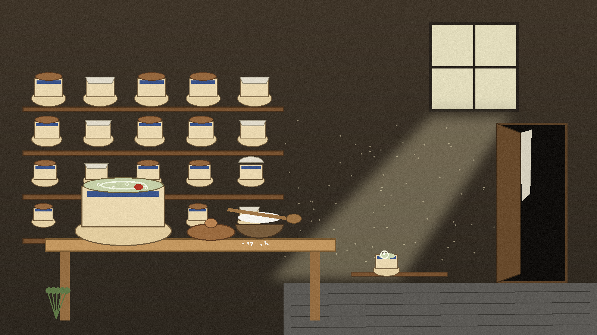
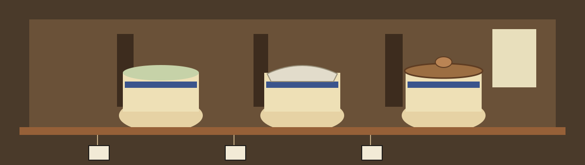

# Printable-Bookmark
Printable Bookmark Generator





## Shelf one: what this script does

Printable-Bookmark is a Python script, run as `python3 main.py`, that
downloads the pin pages linked from a single Pinterest board devoted to
printable bookmarks. It saves pages. It does not design bookmarks, draw
them, or lay them out for a printer.

## Shelf two: the ingredients

Two packages beyond the standard library: `requests` and
`beautifulsoup4`. The built in `html.parser` does the parsing, on
purpose, so the install list stays at two.

```bash
pip install requests beautifulsoup4
python3 main.py
```

## Shelf three: the method

1. The board address is read from one constant at the top of main.py,
   `BOARD_URL`, the only thing a user is expected to change.
2. `fetch` asks for a page with a 15 second timeout per request, and
   reports network failures and HTTP failures as separate messages.
3. `find_printable_bookmarks` hunts the board markup for links carrying
   the pin class in `PIN_LINK_CLASS`, currently `GrowthUnauthPinImage`,
   and resolves relative links against the Pinterest host.
4. `download_printable_bookmark` writes each pin page in binary, exactly
   as it arrived, under a file name taken from the last segment of its
   address by `filename_for`, with no extension invented.
5. The run counts only the saves that succeeded.

## Shelf four: the keeping notes

> **Keeper note, on a loose tag:** if two pins end in the same final
> segment, the later save overwrites the earlier one without warning,
> and the count still rises for both.

> **Keeper note, on a loose tag:** if nothing is saved, the script
> prints that the board may be empty or that Pinterest may have changed
> its markup, and it exits with status 1 rather than pretending success.

> **Keeper note, on a loose tag:** the pin link class name is a
> maintenance point. Pinterest can change its markup without notice,
> and when it does, this script finds no pins and says so.
